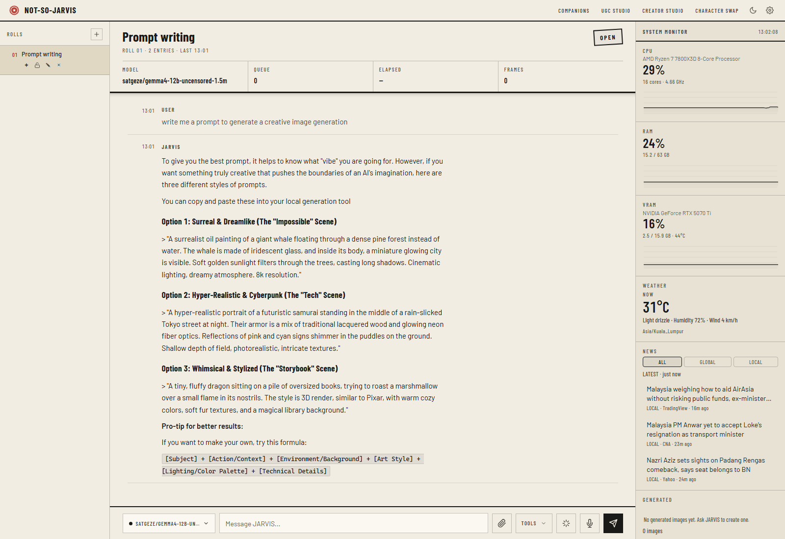
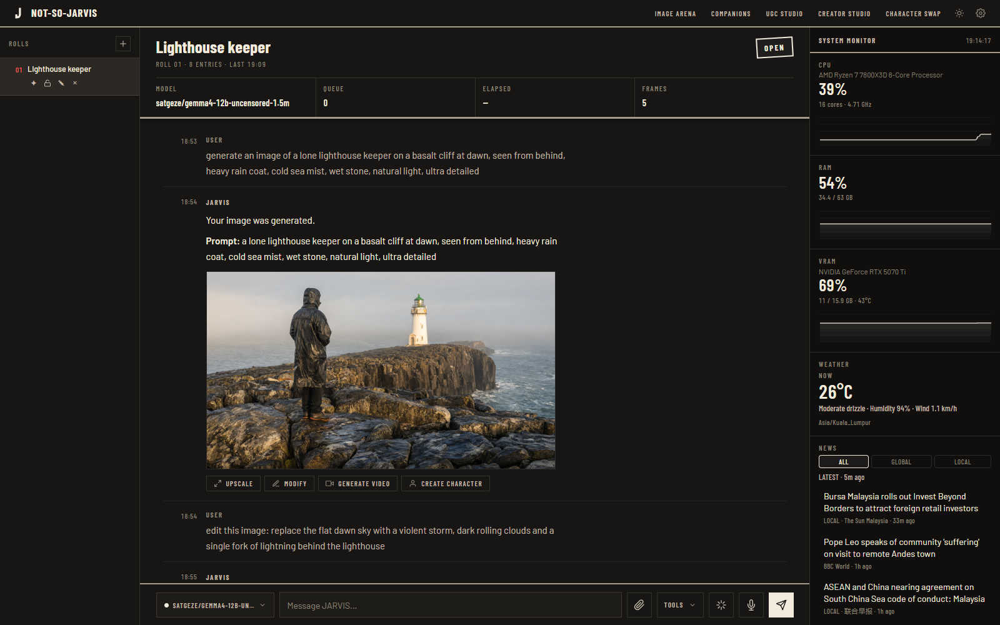
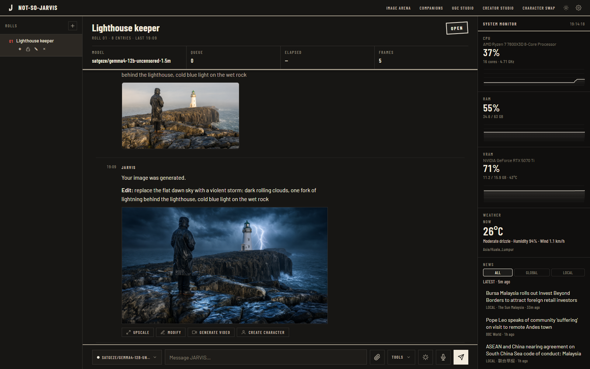
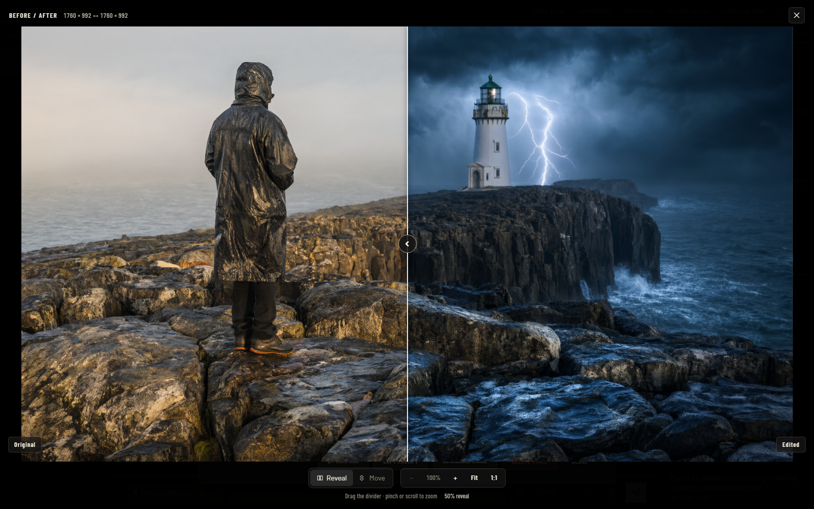
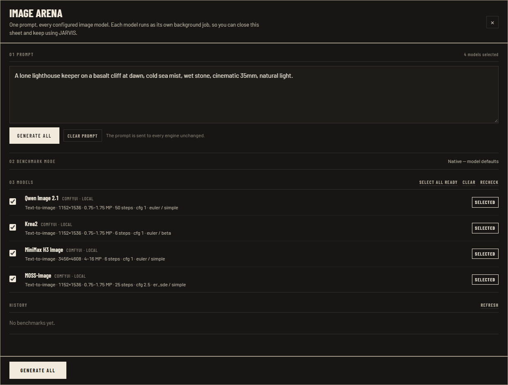
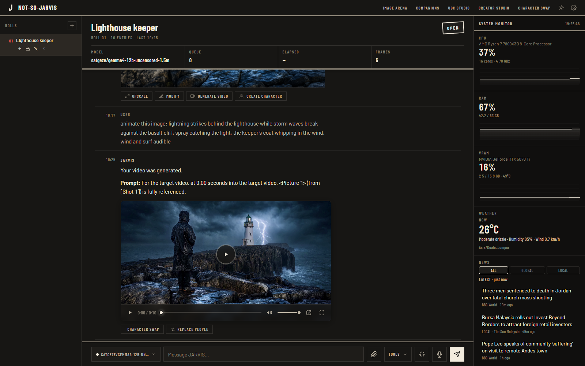
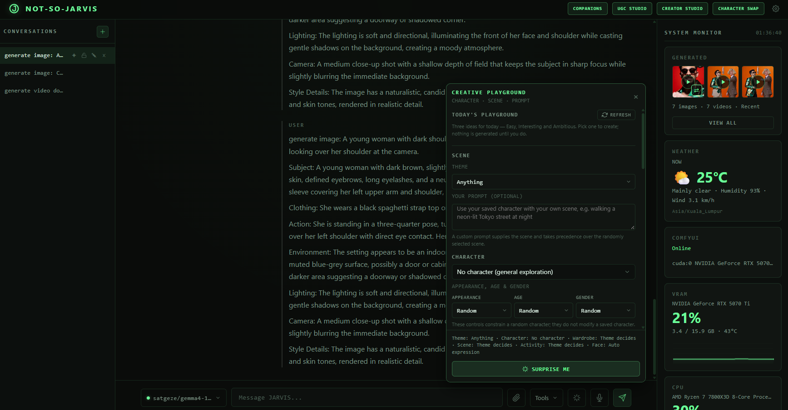
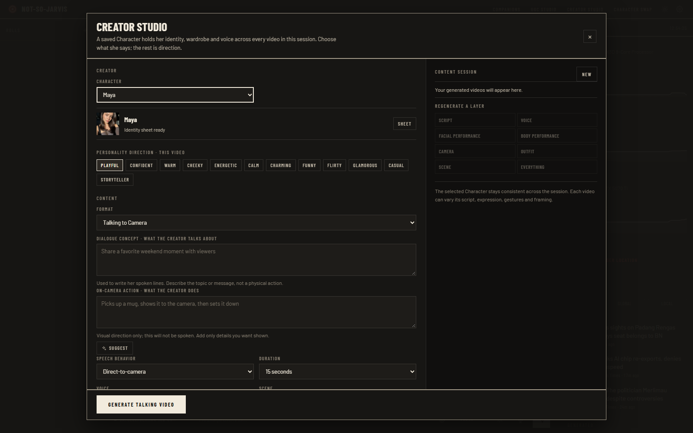
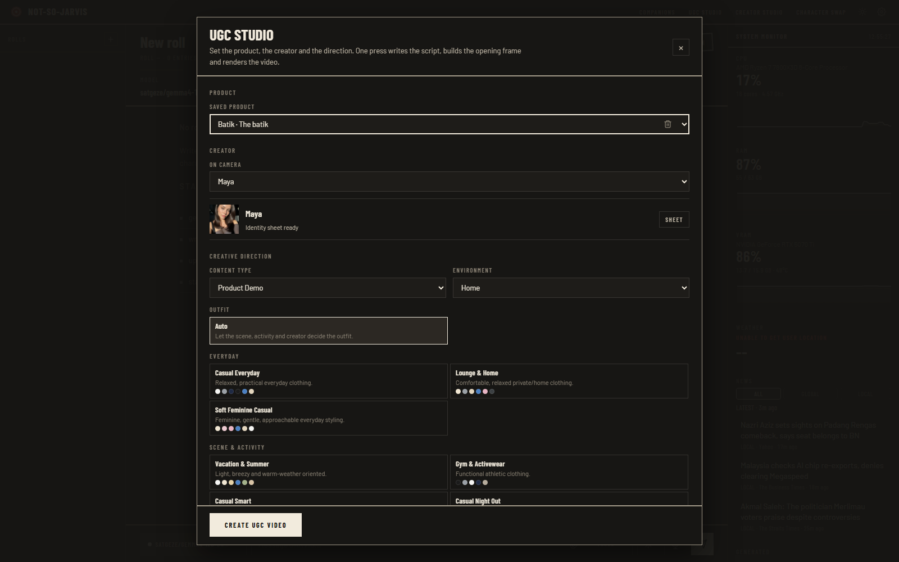
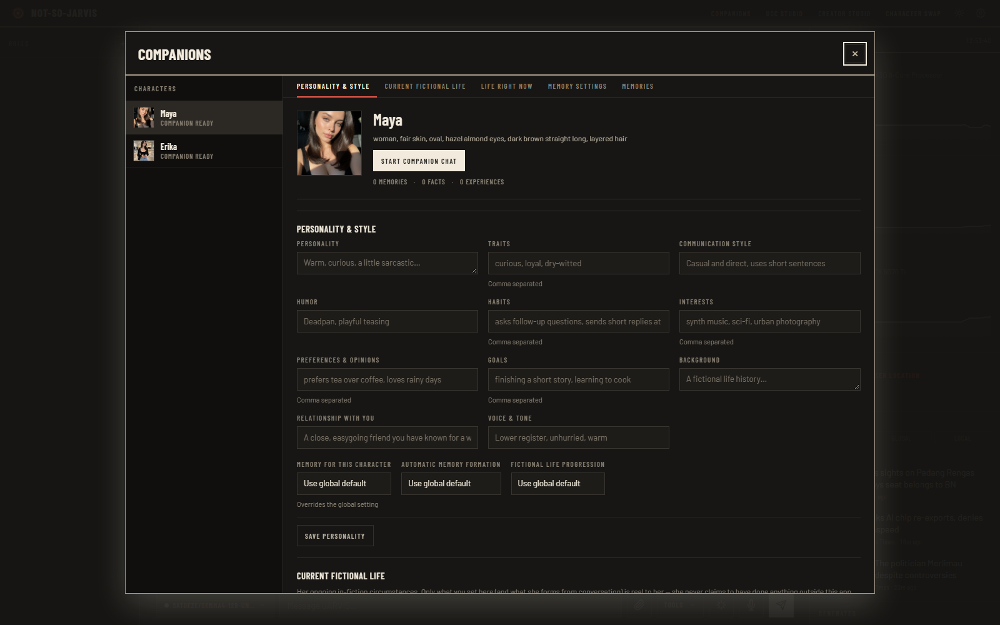

# not-so-jarvis

**JARVIS** is a local AI assistant dashboard: chat, image generation, image editing, video with sound, character replacement, UGC ads, character creation and persistent companions — from one conversation, on your own GPU.

Plain Node.js with **zero npm dependencies**, a vanilla HTML/CSS/JS frontend, and no build step. No cloud, no accounts, no telemetry.



## Features

### One conversation, every pipeline

- **Intent routing** — every message is classified (chat, image, edit, video, upscale, prompt writing) before anything runs. Media words alone never trigger a tool, so *"write me a prompt for an image"* stays a writing task.
- **Active task** — the current image or video session is remembered across turns and restarts, so *"make her outfit a golden silk dress"*, *"another one"*, or *"now animate it"* work without restating the brief.
- **`@` references** — attach earlier images or clips by typing `@`; questions use them as vision, instructions route to a multi-reference edit, video wording routes to image-to-video.
- **Streaming and control** — SSE token streaming, live job progress, cancellable generations, queued follow-ups, voice input and spoken replies.
- **One resident model family** — Ollama and ComfyUI swap in and out of VRAM around each turn, and turns are serialized so two devices on the LAN can never fight over the GPU.

### Image

- **Text-to-image** on local ComfyUI via Qwen Image 2.1 (default), Krea2, MiniMax H3 Image or MOSS-Image.
- **Image edit** by instruction, with multiple positional references (*"make image 1 hold image 2"*) and four selectable edit engines.
- **Upscaling** with SeedVR2 or Ultimate SD; any edit or upscale pairs with its source in a before/after compare.
- **LoRA stack** — per-LoRA strength, on/off, and automatic trigger words.

<p align="center">
  <br>
  <sub><em>A generated frame, its prompt, and the actions that follow it</em></sub>
</p>

<p align="center">
  <br>
  <sub><em>Modify: “replace the flat dawn sky with a violent storm…” — same frame, same keeper</em></sub>
</p>

<p align="center">
  <br>
  <sub><em>Built-in compare, original ↔ edited</em></sub>
</p>

### Image Arena

- **One prompt, every model** — each configured text-to-image engine runs as its own background job: Qwen Image 2.1, Krea2, MiniMax H3 Image and MOSS-Image.
- **Native or Controlled** — Native uses each engine's own defaults; Controlled sends the same resolution, seed and optionally steps/CFG to all of them and reports what could not be standardized.
- **Real comparison** — live job state, timing, resolution, seed, steps and sampler per model, side-by-side zoom, favourites, retry, cancellation and session history.
- **Battle** — blind A/B votes with an Elo leaderboard and per-model win records; the names behind the images stay hidden until the set is judged.
- **Two ways to play (opens on New images)** — write a prompt or let the chat model write a creative one (a complex, layered scene composed for comparison, with a local fallback pool when the model is busy) and every ready engine renders it (no fighter picking), or vote on benchmarks you already ran. Mid-set you only see which side you preferred; the finished set opens with every image beside the model that made it.
- **Never blocks the app** — jobs queue one GPU job at a time, closing the sheet or reloading never interrupts a run, and a restart marks interrupted jobs failed instead of completed.



### Video

- **MiniMax H3 video with synchronized audio** — text-to-video-audio and image-to-video-audio.
- **Director Mode** — brief → opening-frame approval → video, with film-style shot lists and contextual direction changes.
- **Long Video Director** — requests beyond H3's 15-second ceiling become one motion-continuous beat chain rendered in a single job.
- **Finishing passes** — optional FaceRefine, frame interpolation, and RTX or SeedVR2 upscaling that keeps the audio.

<p align="center">
  <br>
  <sub><em>The edited frame animated into a 10-second clip with sound</em></sub>
</p>

<p align="center">
  <video src="screenshots/video.mp4" width="72%" controls muted loop playsinline></video><br>
  <sub><em>The same clip, with synchronized audio</em></sub>
</p>

### Character Swap

Replace a person in an existing clip with a character you supply, using either **SCAIL-2** (default; official replacement mode with SAM 3.1 masks and continuation rendering) or **MiniMax H3 Recast** (one-pass BFS swap with automatic FaceRefine lip repair). The original soundtrack is preserved, and switching engines never discards your clip, trim or takes.

### Characters

- **Character Identity System** — one approved portrait plus one consolidated identity sheet keep a saved character consistent across images, video and every production pipeline.
- **Creative Playground** — deterministic concept discovery: themes, 12 Outfit Packs, 21 activities, a seed-based character generator, and locks you can re-roll one at a time. **Today's Playground** proposes three daily ideas; **News** turns headlines into meme or editorial concepts.
- **Creator Studio** — character-led talking videos with guide-driven scripts, previewed as one opening frame before any GPU video time.
- **UGC Studio** — a chat-first ad workflow with a Product Library and facts-only scripts, handing its approved opening frame to the Director's H3 stage.
- **Companions** — per-character personality, long-term memory, a fictional daily life, and context-aware photos on request.
- **Photo inbox** — a character set to share photos on her own sends a selfie and a short message from her current day without being asked; the header badge shows what arrived, and a photo can be deleted on its card, selected in bulk, or cleared with Delete all.

<table align="center">
  <tr>
    <td align="center" valign="top" width="50%">
      <br>
      <sub><em>Creative Playground</em></sub>
    </td>
    <td align="center" valign="top" width="50%">
      <br>
      <sub><em>Creator Studio</em></sub>
    </td>
  </tr>
  <tr>
    <td align="center" valign="top" width="50%">
      <br>
      <sub><em>UGC Studio</em></sub>
    </td>
    <td align="center" valign="top" width="50%">
      <br>
      <sub><em>Companions</em></sub>
    </td>
  </tr>
</table>

### Dashboard and local tooling

- **SYSTEM MONITOR** — live CPU, RAM and GPU/VRAM telemetry.
- **Live context** — weather (Open-Meteo) and keyless RSS news, including local-area search and the current topic, injected into chat only when you ask about them.
- **Gallery** — thumbnails, zoom/pan previews, grouped upscales, before/after compare, copy prompt, reuse seed, download.
- **Model library** — browse, download, load and unload Ollama models with hardware-compatibility detection.
- **Setup guide** — checks your ComfyUI install and downloads missing models from Hugging Face and Civitai, plus missing custom node packs.
- **Local agent** — reads system metrics, model state, ComfyUI logs and temp files server-side, and deletes temp files only after you approve; anything it cannot do is reported with a real reason rather than faked.

## Requirements

- **Node.js LTS** — no `npm install`; the project has no dependencies.
- **[Ollama](https://ollama.com)** on `localhost:11434` for chat.
- **[ComfyUI](https://github.com/comfyanonymous/ComfyUI)** on `127.0.0.1:8188` for image, video and upscale work, with the models and custom nodes the **Settings > Setup** guide installs for you. If ComfyUI is installed but offline, JARVIS can start it.
- **NVIDIA GPU** — 16 GB VRAM runs the full image, video and upscale stack. 64 GB of system RAM is recommended for video upscaling, which holds both the source and the upscaled output in memory.

> Developed and tested on 16 GB VRAM + 64 GB RAM. The optional model set is large (60 GB+); nothing is downloaded without your click.

## Quick start

```bash
npm start
```

Or use the launcher for your platform, which installs Node.js if it is missing and relaunches the server after a restart request:

- **Windows** — double-click `start.bat`
- **macOS / Linux** — `bash start.sh`

Then open **http://localhost:3001**.

**From another device on the same WiFi,** open `http://<this-machine-ip>:3001` — the LAN URL is printed at startup. Set `HOST=127.0.0.1` in `.env` to keep it local-only. Each device is its own session: conversations, gallery and activity are private to that browser.

## First-run setup

If an image or video feature reports a missing piece, open **Settings > Setup**:

1. Install and start **ComfyUI**.
2. Paste a Hugging Face read token (and, for H3 Recast, a Civitai API key) so licensed models can download.
3. Click **Download all missing**, then **Install all missing** for custom nodes.
4. **Restart ComfyUI.**

Green indicators mean image, video, edit and upscale are ready.

## How it works

- **Routing** — a fast regex signal decides whether a structured classifier is consulted; the classifier's JSON, never the chat model's prose, authorizes a tool.
- **VRAM** — before a chat turn ComfyUI is unloaded; before a generation every Ollama model is unloaded, with the release verified before ComfyUI loads.
- **Image** — prompt → graph built for the selected engine → queued to ComfyUI → progress over SSE → file saved to `data/generated/` and shown inline.
- **Video** — H3 animates one approved opening frame (or text only); the character, outfit, scene and composition are resolved upstream by Qwen Image 2.1.
- **State** — all persistence is JSON under `data/`, with conversations mirrored to IndexedDB in the browser.

## Architecture

- **No framework, no build** — a Node `http` server with path-based routing in `server.js` and a vanilla JS frontend.
- **Plain-object services** — backend modules export named functions; `server/` holds app logic, `services/` the pipelines and integrations.
- **Pipelines stay separate** — `services/image-generator.js` and `services/video-generator.js` own graph construction; routers decide *what* runs, never *how*.
- **One job at a time** — a generation lock plus a turn queue keep the GPU, the models and the ComfyUI queue coherent.

## Development

```bash
npm test
```

Node's built-in test runner, no dependencies. Suites cover routing and intent classifiers, Director, the Playground, outfit and scene resolution, the agent runtime and each media pipeline, with model and storage seams stubbed. Add positive **and** negative phrase cases whenever you change a router regex or gate.

See [`AGENTS.md`](AGENTS.md) for architecture notes and contribution constraints.

## License

MIT — see [LICENSE](LICENSE). JARVIS claims no ownership of media you create.
